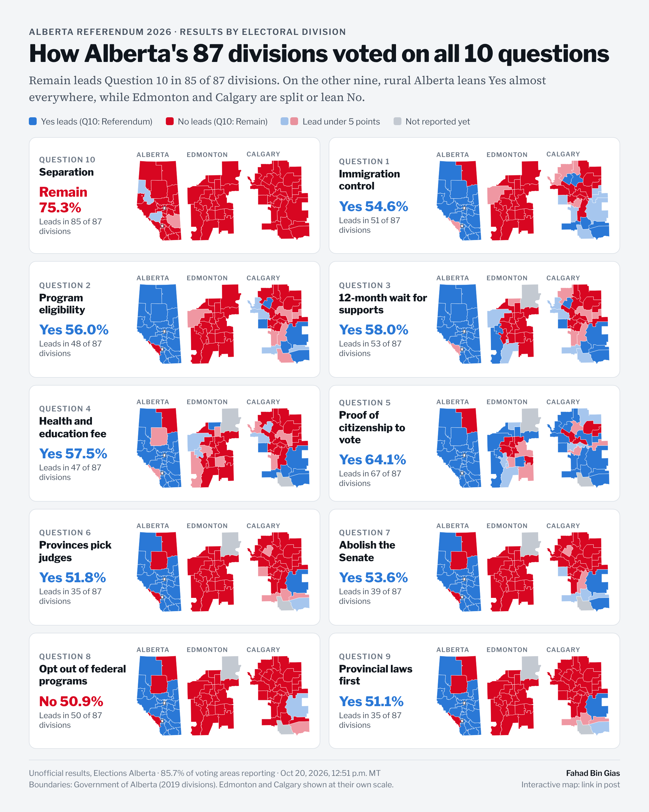
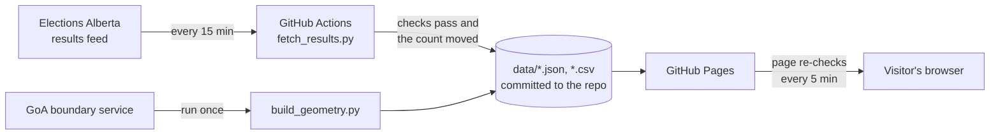

# Alberta Referendum Maps

Live, interactive maps of the October 19, 2026 Alberta referendum: which side leads in each of the province's 87 electoral divisions, on all 10 questions.

**Live site:** https://fahadbgias.github.io/alberta-referendum-2026-maps/



## What it shows

- Pick any of the 10 questions to colour every division by the side that leads there. On Questions 1 to 9, blue is Yes and red is No. On Question 10, red is Remain and blue is Referendum.
- Edmonton and Calgary are drawn at their own scale, so all 46 city divisions are visible next to the province map.
- Select a division to see its votes, its margin and how many of its voting areas have reported.
- A small-multiples grid shows all 10 questions side by side.
- The results are downloadable as a CSV: [`data/results.csv`](data/results.csv).

## How it stays up to date



Elections Alberta's results page loads its numbers from a JSON feed (`/data/8400?questions=N`). That feed can't be read directly from another website's page, so a scheduled GitHub Actions workflow reads it on GitHub's servers instead:

1. `scripts/fetch_results.py` downloads the division-level results for each question. If the feed's data version changes (it did on referendum night), the script reads the current version and question IDs from the results page and tries again.
2. It checks the data (below) and writes `data/results.json`, `data/results.csv` and a running `data/history.csv`.
3. If the count moved, the workflow commits the new files and republishes the site. If nothing changed, it does nothing.

Every update is a commit, so the repo history is a record of how the count changed over time. `data/history.csv` keeps the province-wide totals at each step.

The boundaries come from the Government of Alberta's map service. `scripts/build_geometry.py` simplifies them on the server (about 30 m for city divisions, about 1 km for rural ones) and turns them into compact SVG paths, so the page draws the maps with no mapping library. Boundaries don't change between elections, so this runs by hand.

## Data checks

- **Completeness:** every question must have all 87 divisions, or the run fails and the previous data stays up.
- **Totals:** the divisions must add up to the feed's own province-wide totals. A mismatch is logged as a warning.
- **Impossible counts:** in each division, a question's total votes should not be higher than the ballots counted there on Question 10, which was counted first. Divisions that break this rule are flagged on the map and in the CSV, and shown exactly as published. On referendum night this caught Calgary-Varsity on Question 1 (48,256 votes against 20,288 Question 10 ballots) and Grande Prairie-Wapiti on Questions 4 to 7.

## Run it yourself

```bash
python scripts/fetch_results.py          # refresh data/ from the live feed
python -m unittest discover tests        # tests use a local mock of the feed
python -m http.server 8000               # then open http://localhost:8000
```

Python 3.10+ with the standard library only. No packages to install.

## Set up your own copy

1. Push this folder to a public GitHub repository named `alberta-referendum-maps`.
2. In the repo: **Settings → Pages → Build and deployment → Source: GitHub Actions**.
3. **Actions → Update results → Run workflow** to publish the first version. After that it runs every 15 minutes.
4. Replace `YOUR-GITHUB-USERNAME` in `index.html` and this README with your GitHub username, so link previews on LinkedIn show `preview.png`.
5. When counting is finished, disable the workflow: **Actions → Update results → ⋯ → Disable workflow**.

## Sources

- Results: [Elections Alberta, 2026 Referendum unofficial results](https://results.elections.ab.ca/8400). Unofficial until the official results on October 29, 2026.
- Boundaries: [Government of Alberta, Provincial Electoral Divisions (2019)](https://geospatial.alberta.ca/titan/rest/services/boundary/goa_administrative_area_10tm_nad83_aep/MapServer/3).

Independent analysis by [Fahad Bin Gias](https://www.linkedin.com/in/fahadbingias). Not affiliated with Elections Alberta or the Government of Alberta.
